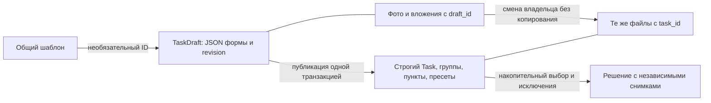

# Схема каталога пет-проектов

Сверено с `app/models/domain.py`, `app/models/enums.py`, схемами и сервисами **08.11.2026**, исходный commit `9d2ea7c`. Head миграций — `fc806193b753`. Документ заменяет исходный drawSQL-экспорт как описание текущей модели.

Правила предметной области ниже сохраняются, но конфигурация пресетов и создание решений сейчас имеют ошибку вызова сервиса. Воспроизведение и исправление описаны в [плане](task-domain-implementation-plan.md). Форматы запросов/ответов — в [API-контрактах](api-contracts.md).

## Назначение и границы

Администратор создаёт задания через браузерную форму и может отдельно изменять каждое требование, пресет и ресурс. Общая библиотека требований помогает повторно использовать идеи. Пользователь выбирает пресет, исключает любые его пункты, создаёт решение с независимым чек-листом и добавляет собственные требования с описанием реализации.

`User` связан с GitHub через уникальный обязательный github_id (BIGINT NOT NULL); verified_emails хранит подтверждённые адреса последнего входа. Эффективная роль is_admin определяется пересечением verified_emails и ADMIN_EMAILS на каждом запросе. auth_sessions хранит token_hash (PK), user_id (FK CASCADE) и expires_at с часовым поясом. Сессия действует 24 часа, выход удаляет её. CRUD пользователей не реализован. Существующие `ContactRequest` и API обращений сохраняются.

Новая предметная область содержит двенадцать таблиц, дополнительно к существующей `contact_requests`.

`TaskDraft` хранит всю неполную форму нового задания и принадлежит конкретному администратору. Фото и вложения привязываются к нему отдельными строками метаданных. При публикации создаётся строгий Task, промежуточного Task со статусом draft нет.

## Общие соглашения

- Физические имена таблиц: `snake_case`, множественное число.
- У каждой новой таблицы есть `id BIGINT GENERATED BY DEFAULT AS IDENTITY PRIMARY KEY`. Типы FK совпадают с типом PK.
- В таблицах ниже поля обязательны, если явно не указано `NULL`.
- Все даты — `TIMESTAMPTZ`. `created_at` и `updated_at`, где они предусмотрены, имеют серверный default `now()`. Изменение записи через SQLAlchemy ORM или Core обновляет `updated_at` через `onupdate=func.clock_timestamp()`. При прямом SQL дату нужно задавать явно.
- Значения перечислений хранятся в нижнем регистре. В БД — строка с именованным `CHECK`; в Python — соответствующий enum. Это не свободные строки.
- Непустые названия проверяются в API. Slug есть только у задания и уникален в таблице tasks.
- В TaskComplicationLink и TaskComplicationLinkGroup хранится только `position` — INTEGER >= 0 среди соседей одного уровня и родителя. Допустимы пропуски. `order_number` отсутствует в БД: API вычисляет его для пунктов с 1 при обходе дерева сверху вниз отдельно для каждого level. У групп нет order_number, они не увеличивают счётчик. В TaskSolutionComplication сохраняется прежний самостоятельный order_number >= 0.
- Циклы иерархий запрещены. Самоссылки запрещаются `CHECK`, циклы из нескольких записей проверяются при изменении родителя.

## Перечисления

| Назначение | Значения |
| --- | --- |
| Направление разработки | `frontend`, `fullstack` |
| Уровень | `easy`, `medium`, `high` |
| Состояние задания | `published`, `archived` |
| Вычисляемое состояние решения | `in_progress`, `completed` |
| Тип ресурса | `design`, `specification`, `asset`, `other` |

Для сравнения уровней используется явный порядок `easy = 0`, `medium = 1`, `high = 2`, а не лексикографическое сравнение строк. Дополнительного числового столбца в БД для этого не требуется.

## 1. User → users

Минимальный автор решения. CRUD API пользователей, регистрация и вход не создаются.

| Поле | Тип / ограничения | Назначение |
| --- | --- | --- |
| `id` | общий PK | Идентификатор |
| `email` | `VARCHAR(255)`, UNIQUE | Email |
| `is_admin` | `BOOLEAN`, default `false` | Доступ к редактору и собственным черновикам |
| `last_login` | `TIMESTAMPTZ`, NULL | Дата входа, пока не используется |
| `created_at`, `updated_at` | `TIMESTAMPTZ` | Даты |

## 2. TaskComplicationCategory → task_complication_categories

Классификация общей библиотеки требований.

| Поле | Тип / ограничения | Назначение |
| --- | --- | --- |
| `id` | общий PK | Идентификатор |
| `title` | `VARCHAR(100)` | Название категории |
| `parent_id` | FK → `task_complication_categories.id`, NULL | Родитель; NULL для корня |
| `developer_type` | enum направления | Frontend / Fullstack |

`type = general / individual` и `group` отсутствуют. Одноразовые требования создаются в `TaskComplicationLink` без общего шаблона. Родитель задаёт иерархию; его классификационные поля автоматически не наследуются.

## 3. TaskComplication → task_complications

Общий шаблон, который администратор выбирает при составлении задания.

| Поле | Тип / ограничения | Назначение |
| --- | --- | --- |
| `id` | общий PK | Идентификатор |
| `category_id` | FK → `task_complication_categories.id` | Категория |
| `title` | `VARCHAR(150)` | Например, «Пагинация» |
| `description` | `TEXT` | Общая суть и назначение требования для администратора |
| `created_at`, `updated_at` | `TIMESTAMPTZ` | Даты |

Полей `slug` и `help_text` нет. Общий `description` не является пользовательской инструкцией и автоматически не копируется в требования задания или решения.

Ссылка на шаблон сохраняет происхождение требования и позволяет находить его применения. Название и описание шаблона нельзя изменять, пока он используется требованиями; для изменения смысла создаётся новый шаблон. Это ограничение действует и для исправления опечаток. Изменение других полей не изменяет уже созданные требования. Ссылки в JSON черновика не являются FK и не блокируют изменение шаблона. Для них при чтении проверяется существование ID, версия текста шаблона не хранится.

## 4. Task → tasks

Идея проекта и общая постановка задачи.

| Поле | Тип / ограничения | Назначение |
| --- | --- | --- |
| `id` | общий PK | Идентификатор |
| `parent_task_id` | FK → `tasks.id`, NULL | Проект-источник |
| `slug` | `VARCHAR(255)`, UNIQUE | Адрес карточки |
| `title` | `VARCHAR(255)` | Название |
| `short_description` | `VARCHAR(300)` | Описание для каталога |
| `full_description` | `TEXT` | Полная постановка |
| `developer_type` | enum направления | Направление проекта |
| `difficulty_from` | `SMALLINT`, 0–10 | Нижняя оценка сложности |
| `difficulty_to` | `SMALLINT`, 0–10 | Верхняя оценка сложности |
| `design_author_name` | `VARCHAR(255)`, NULL | Автор дизайна |
| `design_author_link` | `TEXT`, NULL | Ссылка на автора |
| `status` | enum состояния задания, default `published` | Публикация или архив |
| `is_hidden` | `BOOLEAN`, default `false` | Полностью исключить задание из публичного API |
| `is_paid` | `BOOLEAN NOT NULL`, default `false` | Признак доступа по подписке для карточек и фильтра каталога; сам по себе не проверяет подписку пользователя |
| `created_at`, `updated_at` | `TIMESTAMPTZ` | Даты |

Дополнительный `CHECK`: `difficulty_from <= difficulty_to`. Диапазон — субъективная оценка автора задания, не агрегат оценок решений.

`parent_task_id` означает происхождение: например, fullstack-проект создан на основе frontend-проекта. Связь не наследует тексты, требования или ресурсы. Они редактируются независимо. Требование, что родитель всегда frontend, не вводится.

## 5. TaskComplicationLink → task_complication_links

Конкретное требование задания. Несмотря на название, это содержательная сущность, а не техническая M:N-таблица.

| Поле | Тип / ограничения | Назначение |
| --- | --- | --- |
| `id` | общий PK | Идентификатор |
| `task_id` | FK → `tasks.id` | Задание |
| `group_id` | `BIGINT`, NULL | Группа внутри того же задания и уровня |
| `complication_id` | FK → `task_complications.id`, NULL | Общий шаблон; NULL для одноразового требования |
| `title` | `VARCHAR(255)` | Например, «Пагинация списка фильмов» |
| `description` | `TEXT` | Что реализовать; при необходимости рекомендации по реализации |
| `acceptance_criteria` | `TEXT` | Критерии выполнения |
| `level` | enum уровня | Уровень, начиная с которого требование включается |
| `is_required` | `BOOLEAN`, default `false` | Информационная отметка важности |
| `position` | INTEGER >= 0 | Позиция среди соседних пунктов и групп |
| `created_at`, `updated_at` | `TIMESTAMPTZ` | Даты |

Нет полей `minimum_level`, `how_to_description`, `criteria_description`, `help_text` и связи с конкретным пресетом. Прежний `how_to_description` называется `description`, прежний `criteria_description` — `acceptance_criteria`.

Нет уникальности `(task_id, complication_id)`: один шаблон может породить несколько требований, например пагинацию фильмов и сотрудников.

Администратор адаптирует требование вручную или копирует уже заполненное требование другого задания с сохранением `complication_id`. Автоматической синхронизации копий нет. Стек, зависимости и несовместимость требований не моделируются.

При изменении названия, описания или критериев связанного требования PATCH явно передаёт `complication_id`: прежний ID, другой либо NULL. Это подтверждает выбор связи, но не является автоматической проверкой соответствия смысла текста.

## 6. TaskLevelPreset → task_level_presets

Описание готового уровня задания. Состав определяется уровнем требований, отдельной таблицы состава нет.

| Поле | Тип / ограничения | Назначение |
| --- | --- | --- |
| `id` | общий PK | Идентификатор |
| `task_id` | FK → `tasks.id` | Задание |
| `level` | enum уровня | Easy / Medium / High |
| `description` | `TEXT` | Описание конфигурации |
| `average_days_to_complete` | `SMALLINT`, NULL, > 0 | Оценка времени |
| `created_at`, `updated_at` | `TIMESTAMPTZ` | Даты |

`UNIQUE(task_id, level)`: до трёх пресетов на задание. Не обязательно создавать все три. Для составного FK решения также нужна уникальная пара `(task_id, id)`.

### Накопительный состав

| Уровень требования | Easy | Medium | High |
| --- | --- | --- | --- |
| `easy` | включено | включено | включено |
| `medium` | — | включено | включено |
| `high` | — | — | включено |

Сначала выбираются группы и требования с допустимыми уровнями, затем строится дерево в порядке соседей. Пустые ветки в конфигурации выбранного пресета скрываются. Для решения дерево разворачивается в плоский список. Наличие отдельного пресета более низкого уровня для включения его требований не требуется.

Все пункты состава изначально выбраны. Пользователь вправе убрать любой, включая `is_required = true`. Высокий уровень добавляет требования, не заменяет нижние. Текст и важность одного требования одинаковы во всех пресетах, в которые оно входит.

### Отличие деталей задачи от конфигурации

`TaskDetail.presets` — объект с ключами easy, medium, high. Каждый блок содержит `preset` (метаданные или null) и `complications` только собственного уровня. Пустые группы сохраняются. Ветви без строки TaskLevelPreset также возвращаются, чтобы редактор не терял данные.

`/presets/{id}/configuration` использует накопительные уровни. Например, детальный блок medium содержит только medium, конфигурация medium — easy и medium. Нельзя подменять один расчёт другим.

Для опубликованного задания сервис требует хотя бы один пресет и хотя бы один пункт в накопительном составе каждого существующего пресета. Сам по себе пустой group не является выполнением этого условия. В архивном задании состав может быть временно неполным. Форма нового задания сохраняется в TaskDraft.

## 7. TaskSolution → task_solutions

Одна попытка решения с собственным чек-листом и описанием подхода. Один пользователь может многократно решать одно задание.

| Поле | Тип / ограничения | Назначение |
| --- | --- | --- |
| `id` | общий PK | Идентификатор |
| `task_id` | FK → `tasks.id` | Исходное задание |
| `task_level_preset_id` | составной FK, см. ниже | Пресет при старте |
| `author_id` | FK → `users.id` | Автор |
| `description` | `TEXT`, default `''` | Общее описание собственного решения |
| `difficulty_rating` | `SMALLINT`, NULL, 0–10 | Субъективная оценка пользователя |
| `github_link` | `TEXT`, NULL | Репозиторий |
| `resolved_at` | `TIMESTAMPTZ`, NULL | Дата завершения |
| `status` | вычисляемая строка | `in_progress` или `completed` |
| `task_title_snapshot` | `VARCHAR(255)` | Название задания на момент старта |
| `task_description_snapshot` | `TEXT` | Полное описание задания на момент старта |
| `preset_level_snapshot` | enum уровня | Уровень при старте |
| `preset_description_snapshot` | `TEXT` | Описание пресета при старте |
| `created_at`, `updated_at` | `TIMESTAMPTZ` | Даты |

Составной FK `(task_id, task_level_preset_id) → task_level_presets(task_id, id)` гарантирует принадлежность пресета заданию. Уникальности `(author_id, task_id)` нет.

При создании решения клиент не заполняет `description`, `github_link` и `difficulty_rating`: сервер использует соответственно `''`, NULL и NULL. Эти поля можно заполнить позднее через PATCH. Начальная запись сразу имеет статус `in_progress`; отдельная сущность черновика решения не нужна.

`status` вычисляется в БД, а не независимо изменяется приложением:

```sql
CASE WHEN resolved_at IS NULL THEN 'in_progress' ELSE 'completed' END
```

Технически это `VARCHAR(20) GENERATED ALWAYS AS (...) STORED`. Вычисляемый столбец не принимает прямую запись. Выражение объявлено в модели через SQLAlchemy Computed(persisted=True).

Поля `is_resolved` нет. Завершение устанавливает серверное время, возврат в работу очищает дату. Повторное завершение уже завершённого решения сохраняет исходную дату.

Решение можно завершить при любом состоянии чек-листа, включая пустой список после исключения всех требований. Выполнение всех пунктов не завершает решение автоматически. `github_link` и оценка сложности не обязательны для завершения.

Задание, автор, исходный пресет и снимки после создания решения не меняются через обычный PATCH. Изменение чек-листа не пересчитывает сохранённый уровень: он описывает исходный выбор пользователя.

## 8. TaskSolutionComplication → task_solution_complications

Независимая копия выбранного требования либо собственное дополнение пользователя.

| Поле | Тип / ограничения | Назначение |
| --- | --- | --- |
| `id` | общий PK | Идентификатор |
| `solution_id` | FK → `task_solutions.id` | Решение |
| `original_complication_link_id` | FK → `task_complication_links.id`, NULL | Источник; NULL для собственного пункта |
| `title` | `VARCHAR(255)` | Название |
| `description` | `TEXT` | Что требуется реализовать |
| `acceptance_criteria` | `TEXT`, NULL | Критерии, если есть |
| `implementation_description` | `TEXT`, NULL | Как пользователь реализовал пункт |
| `is_required` | `BOOLEAN`, default `false` | Информационная отметка из исходного требования |
| `order_number` | общий порядок | Порядок в чек-листе |
| `resolved_at` | `TIMESTAMPTZ`, NULL | Выполнение конкретного пункта |
| `created_at`, `updated_at` | `TIMESTAMPTZ` | Даты |

Нет `help_text`, `how_to_description`, `criteria_description`, `is_resolved` или отдельного `status`. Выполнение определяется по наличию `resolved_at`.

При создании решения выбранные требования копируются вместе с названием, описанием, критериями, важностью и порядком. Общие описания из `TaskComplication` не копируются. `implementation_description` сначала NULL.

Источник используется только для происхождения. Отображение решения не подставляет текущие тексты источника. Пользовательские изменения копии не изменяют исходное задание. Для собственного пункта источник всегда NULL.

Источник копируемого пункта должен принадлежать заданию решения. Это проверяется сервисом при создании; перенос существующего исходного требования в другое задание запрещён. Для другого задания создаётся копия.

## 9. TaskResource → task_resources

Метаданные файла задания в S3-совместимом хранилище MinIO.

| Поле | Тип / ограничения | Назначение |
| --- | --- | --- |
| `id` | общий PK | Идентификатор |
| `task_id` | FK → `tasks.id`, NULL | Опубликованное или архивное задание |
| `draft_id` | FK → `task_drafts.id`, NULL, CASCADE | Черновик администратора |
| `title` | `VARCHAR(255)` | Название ресурса |
| `type` | enum типа ресурса | Назначение |
| `object_key` | `TEXT` | Ключ объекта внутри бакета |
| `original_filename` | `VARCHAR(255)` | Исходное имя файла |
| `content_type` | `VARCHAR(255)`, NULL | MIME-тип |
| `size_bytes` | `BIGINT`, NULL, >= 0 | Размер |
| `created_at`, `updated_at` | `TIMESTAMPTZ` | Даты |

Нет `order_number`. Список стабильно сортируется по `id`. Адрес MinIO и единый бакет задаются в настройках приложения. В БД хранится ключ объекта; постоянный URL `/api/media/resources/{id}` формируется из ID вложения.

Новая загрузка получает новый ключ resources/UUID. API не принимает произвольный object_key и не перезаписывает существующий объект. Агрегаты и ответы загрузки возвращают постоянный URL без expires_in и без обращения к хранилищу. Медиапрокси проверяет владельца и видимость по БД перед чтением Redis/MinIO или ответом 304; при скачивании сохраняет исходное имя файла через Content-Disposition.

Исторический набор ресурсов на уровне решения в этой версии схемы не фиксируется. Снимки сохраняют текстовую постановку и требования, но не гарантируют неизменность всех файлов задания.

Ограничение `ck_resource_owner` требует ровно одну непустую ссылку: task_id или draft_id. При публикации обе ссылки меняются одним UPDATE, ID и ключ объекта сохраняются. Файлы черновика доступны только его владельцу.

## 10. TaskDraft → task_drafts

Полная форма нового задания, привязанная к её администратору. Поддерживает сохранение незаполненных и предметно некорректных значений без ослабления Task.

| Поле | Тип / ограничения | Назначение |
| --- | --- | --- |
| `id` | общий PK | Идентификатор формы |
| `owner_id` | FK → `users.id`, RESTRICT | Администратор-владелец, сервер берёт из сессии |
| `payload` | `JSONB`, default `{}`, объект | Поля TaskCreate, дерево `items`, массив `presets` |
| `revision` | `INTEGER`, > 0, default 1 | Ревизия формы и связанных файлов |
| `created_at`, `updated_at` | `TIMESTAMPTZ` | Даты |

Доступ разрешён только владельцу с `is_admin = true`. Другой администратор получает 404, включая файловые операции. Владелец не задаётся и не изменяется через тело запроса. Индекс `(owner_id, updated_at, id)` обслуживает список собственных черновиков.

Размер сериализованного payload ограничен 256000 байт. Неизвестные ключи верхнего уровня и превышение размера отклоняются. Неполные поля, некорректные вложенные пункты и занятый slug не запрещают сохранение. PATCH объединяет поля верхнего уровня, массивы items и presets заменяются целиком. NULL очищает поле формы, непереданные поля сохраняются. Файлы хранятся в TaskPhoto и TaskResource с draft_id, а не внутри JSON.

Ожидаемая revision обязательна для изменения формы, фотографий, ресурсов, удаления и публикации. Успешное изменение увеличивает её, конфликт возвращает 409. Загрузка файлов не держит блокировку во время передачи в MinIO, после загрузки ревизия и существование владельца проверяются повторно. При конфликте новый объект удаляется.

Каждое чтение, список и сохранение возвращают вычисленные `validation_errors: [{field, code, message}]`, `is_valid`, `photos` и `resources` со стабильными URL. Проверяются поля Task, дерево требований, ссылки на шаблоны, пресеты, актуальная уникальность slug и существование родителя. Путь ошибки указывает конкретный вложенный элемент. Ошибки не хранятся в таблице, чтение не меняет revision/updated_at и не резервирует slug.

`POST /editor/task-drafts/{id}/publish` блокирует черновик, повторно проверяет владельца, ревизию и полную форму. В одной транзакции создаются Task со статусом published, группы, требования и пресеты, файлы перепривязываются с draft_id на task_id, затем TaskDraft удаляется. Перенос сохраняет ID файлов и ключи MinIO без копирования объектов. При ошибках валидации возвращается 422 с подробностями, при отказе транзакции исходная форма и её привязки сохраняются.

Новые группы и требования в payload не имеют ID записей БД. Хотя бы один пресет обязателен, состав каждого должен быть непустым с учётом накопительного уровня. Отдельная ветка редактирования уже опубликованного задания не входит в этот формат.

## Целостность, удаление и индексы

- Используемые задания архивируются. Удаление задания не удаляет пользовательские решения.
- Удаление пользователя с решениями блокируется FK. Управление пользователями в API не реализуется.
- Используемые категории и общие шаблоны защищены от удаления: сначала требуется явное перемещение или отвязка зависимых записей.
- Родители задач и категорий защищены от удаления, пока существуют дочерние записи.
- Пресеты, на которые ссылаются решения, и требования, на которые ссылаются пункты решений, защищены от удаления. Их редактирование не переписывает снимки.
- Удаление решения может каскадно удалять только его собственные пункты.
- Удаление TaskDraft каскадно удаляет метаданные его файлов. Физическое удаление Task разрешено только для неиспользуемой архивной записи с проверкой внешних ссылок. Сервис сохраняет ключи в pending_file_deletions в той же транзакции и удаляет файлы MinIO после commit; при ошибке удаления задача остаётся в очереди.
- Для иерархий задаются корректные FK `parent_id → id`, а не обратные связи из исходного SQL.
- FK индексируются с учётом левых префиксов составных индексов; уникальные индексы не дублируются.
- Основные составные индексы: требования `(task_id, level, position, id)`, пункты решения `(solution_id, order_number, id)`, решения `(author_id, created_at, id)` и каталог `(status, developer_type, id)`.
- Уникальные ограничения: email пользователя, slug задания, `(task_id, level)` пресета и техническая `(task_id, id)` пресета.

## Зафиксированные исключения из объёма работ

Не добавляются CRUD пользователей, зависимости/конфликты требований, привязка к стеку, автоматическое наследование задания от родителя, синхронизация текстов копий или таблица `TaskLevelPresetComplication`.

Compose и Makefile настроены для PostgreSQL, MinIO и backend. Для тестов согласованы Testcontainers и create_all/drop_all. Обнаруженное исключение с запуском миграции в test_template_slug.py описано в плане. Рабочее приложение применяет Alembic при Docker-запуске.


## 11. TaskComplicationLinkGroup → task_complication_link_groups

Именованная группа конкретных требований внутри задания с вложенными группами.

| Поле | Тип / ограничения | Назначение |
| --- | --- | --- |
| id | общий PK | Идентификатор группы |
| task_id | FK → tasks.id | Задание |
| parent_group_id | BIGINT, NULL | Родительская группа, NULL для корня |
| title | VARCHAR(255) | Название |
| level | enum уровня, обязательно | Собственный уровень группы |
| position | INTEGER >= 0, default 0 | Порядок среди соседей |
| created_at, updated_at | TIMESTAMPTZ | Даты |

Уникальная тройка `(task_id, level, id)` служит целью составных FK. Группа ссылается через `(task_id, level, parent_group_id)`, пункт — через `(task_id, level, group_id)`. Это запрещает смешивать задания и уровни даже при записи напрямую в БД. FK отложены до конца транзакции, что позволяет перенести целую ветку на другой уровень одним сохранением. CHECK запрещает родителя, равного себе, и отрицательный порядок.

Группа не ссылается на TaskLevelPreset. Поэтому она может существовать при отсутствии метаданных пресета своего уровня. Все потомки должны иметь её level, в том числе пустые группы.

API сохраняет дерево целиком вместе с полями и пресетами через `PUT /editor/tasks/{id}`, сохраняет ID существующих объектов и отклоняет повторные/чужие ID. Пропущенные элементы удаляются. Если требование используется решением, его удаление блокируется и весь запрос откатывается. Допускается до 10 уровней и 1000 элементов. Порядок массива определяет position соседей, вложенность — родителя. order_number вычисляется только при формировании ответа API, без UPDATE и изменения updated_at. Полный PUT задаёт позиции с нуля отдельно внутри каждого уровня и родителя. Точечное удаление/перенос может оставить пропуски в исходном контейнере; они не влияют на видимую нумерацию.

Дерево ответа содержит `kind: complication | group`, дети группы находятся в items. В детальных блоках уровней пустые группы видны, в накопительной configuration пустые ветки скрыты. Решение получает плоские снимки пунктов в порядке обхода дерева.

## 12. TaskPhoto → task_photos

Фотографии задания хранятся отдельно от файлов-ресурсов. Поля: общий `id`, nullable `task_id` и `draft_id`, `position`, `object_key`, `original_filename`, `content_type`, `size_bytes`, `created_at`, `updated_at`. Все даты имеют часовой пояс.

`position` принимает значения 1–4. У готовой задачи обязательно хотя бы одно фото: API проверяет это при публикации/сохранении и запрещает удаление последнего. Черновик можно сохранить без фото. CHECK требует ровно одного владельца: task_id или draft_id. Отложенная до конца транзакции уникальность `(task_id, position)` и `(draft_id, position)` разрешает перестановку фотографий и вместе с CHECK ограничивает число записей четырьмя. API поддерживает последовательные позиции от 1, позиция 1 является титульной (`is_cover` вычисляется при чтении). В БД хранится ключ объекта, URL создаётся при чтении.

Пакетная загрузка и сохранение списка галереи сериализуются блокировкой задания или черновика. Для черновика также проверяется и увеличивается revision. Титульное фото выбирается первым ID в списке, отсутствующие ID удаляются. Допускается пустая галерея. Реальные изображения проверяются Pillow, поддерживаются JPEG/PNG/WebP до 20 миллионов пикселей и MAX_PHOTO_BYTES байт.

## Публикация, скрытие и версия черновика

`is_hidden` независим от статуса. Скрытое задание недоступно в публичном API, даже по прямой ссылке. `/editor/tasks` показывает администраторам все состояния. Существующие решения доступны своим владельцам.

`schema_version` удалён. `revision` защищает форму и файлы от конкурентной записи. Task имеет только статусы published и archived. Миграция `d53ae017b804` переводит прежние Task.draft в скрытый архив со всеми связями, поскольку владельцы этих записей неизвестны. Старые TaskDraft продолжают хранить сохранённые поля и допускают добавление items, presets и файлов.

## Архитектура операций и причины решений



- JSONB решает задачу неполной формы, строгие таблицы защищают опубликованные данные. Отдельных черновых таблиц групп и пунктов нет.
- Блокировка строки Task согласует изменение состава и создание решения. TaskDraft использует блокировку плюс revision. Для смены родителей Task/категорий есть транзакционная advisory-блокировка Hierarchy, цепочка предков читается одним рекурсивным CTE. Блокировка строки не заменяет защиту от устаревшей формы опубликованного задания.
- Файлы сначала передаются в MinIO без блокировки владельца. Перед сохранением метаданных повторно проверяются владелец, revision и лимит. БД и MinIO не имеют общей транзакции.
- discard_upload пытается откатить БД и удалить каждый новый объект даже при сбое rollback или удаления другого объекта. Ошибки очистки логируются, исходная ошибка сохраняется. Остановка процесса не гарантирует компенсацию.
- Удаление задачи, черновика, фото из галереи или вложения сохраняет (bucket, object_key) в pending_file_deletions вместе с удалением метаданных. После commit выполняется попытка удаления из MinIO с повторной проверкой ссылок в TaskPhoto и TaskResource. При сбое запись сохраняется с next_attempt_at для фонового повтора. Публикация черновика сохраняет файлы и не создаёт записи очистки.
- Списки Task выбирают титульные фото одним дополнительным запросом на страницу. Библиотека и дерево состава используют по два запроса. Список TaskDraft пока валидирует и читает файлы каждой формы отдельно.

Вычисляемые поля ответа не являются колонками Task: cover_photo, photos, resources, presets. Список содержит только cover_photo, детали — весь набор. Отдельная схема TaskPublication принимает items и массив presets, не форму TaskDetail.


### Оптимизация очереди очистки — 09.11.2026

Проверка ссылок в TaskPhoto и TaskResource выполняется одним запросом UNION ALL для всей пачки (до 100 ключей); при пустой очереди таблицы файлов не читаются. Для TaskResource.object_key добавлен индекс. Поле pending_file_deletions.attempt_count начинается с 0 и увеличивается перед каждой попыткой удаления, включая ошибку получения клиента хранилища; номер выводится в журнале ошибки. Внутренние сетевые повторы boto3 не учитываются. Счётчик сохраняется вместе с результатом обработки пачки: при откате этой транзакции или аварийной остановке он может не отразить последний вызов. После успешного удаления запись очереди удаляется вместе со счётчиком; история успешных удалений не хранится. Повторы остаются без ограничения числа попыток с задержкой 60 секунд.


## Атомарная запись и краткий список черновиков — 09.11.2026

TaskSave объединяет TaskCreate с обязательными массивами items/presets. Статус меняется отдельным PATCH. При полном PUT существующий пресет определяется уровнем и сохраняет ID; пункты и группы определяются ID. Пропущенные элементы удаляются с учётом FK решений. Сервис проверяет итоговый состав опубликованного задания и возвращает TaskDetail до единственного commit. Неуспешная запись откатывается целиком.

DraftSummary содержит id, title, short_description, revision, created_at, updated_at и cover_photo. Список не валидирует формы и не читает полные payload/ресурсы: count, проекция полей JSON и пакет обложек требуют трёх запросов на непустую страницу. Полный DraftRead и проверка ошибок сохранены при чтении одного черновика, изменении и публикации. Модель хранения не менялась.


### Отдельное чтение пресетов — 09.11.2026

GET `/tasks/by-slug/{slug}/presets` и `/editor/tasks/{id}/presets` используют тот же `catalog.task_presets`, что и TaskDetail: все уровни с собственными пунктами и группами, без накопления. Неиспользуемые внешние GET configuration удалены. Накопительная выборка `composition.configuration` сохранена только внутри создания решений, поэтому семантика существующих снимков и выбранного уровня не меняется.
